# 02 — Current System Architecture

> **Module:** Reverse-Engineered System Architecture & Baseline Verification  
> **Status:** Grounded in Verified Source Code  
> **Target Audience:** Principal Architects, Systems Engineers, Full-Stack Developers

---

## 1. Executive Architecture Summary

The existing system is implemented as a full-stack TypeScript monolith utilizing the **Next.js 14 App Router** paradigm, coupled with **Supabase Managed PostgreSQL** as the persistent relational datastore, and **Razorpay** as the payment processing gateway.

The architecture combines React Server Components (RSC) for initial page hydration, Client Components for rich client interactivity (GSAP scroll physics, Lenis smooth scrolling, and dynamic HTML5 Canvas rendering), Next.js Edge Middleware for zero-latency perimeter authentication, and Node.js Route Handlers (`server-only`) for secure transactional backend operations.

---

## 2. Verified Technology Stack

```
┌────────────────────────────────────────────────────────────────────────┐
│                        VERIFIED TECHNOLOGY STACK                       │
├──────────────────────┬─────────────────────────────────────────────────┤
│ Layer                │ Technologies & Versions                         │
├──────────────────────┼─────────────────────────────────────────────────┤
│ Frontend Framework   │ Next.js 14.2.25 (App Router, Server/Client Comps)│
│ UI Runtime           │ React 18.3.1, ReactDOM 18.3.1                   │
│ Language & Tooling   │ TypeScript 5.4.5, Node.js 20.x, PostCSS 8.4     │
│ Styling & Design     │ Tailwind CSS 3.4.3, clsx 2.1, tailwind-merge 2.3 │
│ Animation & Motion   │ GSAP 3.15.0, Lenis Smooth Scroll 1.3.27         │
│ Iconography          │ Lucide React 0.379.0                            │
│ Database Platform    │ Supabase Managed PostgreSQL 15                  │
│ Database Client      │ @supabase/supabase-js 2.45.0                    │
│ Payment Integration  │ Razorpay Node SDK 2.9.8, Webhook HMAC Engine    │
│ Cryptography & Auth  │ Node.js native crypto, Web Crypto Subtle API    │
│ Image & Canvas API   │ Sharp 0.35.5, HTML5 Canvas 2D Rendering Engine  │
└──────────────────────┴─────────────────────────────────────────────────┘
```

---

## 3. Frontend Architecture

The client-side application is organized into route segments under `src/app/` leveraging the Next.js 14 App Router conventions:

1. **Root Layout (`src/app/layout.tsx`):**
   - Injects global Google Fonts (`Geist`, `Cabinet Grotesk`).
   - Configures global metadata, OpenGraph tags, and Favicons.
   - Envelops the tree in `SmoothScrollProvider` (Lenis + GSAP unified ticker loop).
   - Injects global navigation (`Navbar.tsx`, `MobileBottomNav.tsx`) and `Footer.tsx`.

2. **Component Separation Model:**
   - **Marketing & Content Components (`src/components/landing/`):** Pure presentation components (`HeroSection.tsx`, `ProblemSection.tsx`, `TransformationTimelineSection.tsx`, `PricingOfferSection.tsx`, `FaqAccordion.tsx`, `WhoBuildsSection.tsx`). Highly optimized for Core Web Vitals with GSAP scroll-triggered reveals (`ScrollReveal.tsx`).
   - **Interactive Modal Dialogs (`src/components/contest/`):** `ContestRulesModal.tsx` provides both a quick summary and complete 9-section official rules, featuring body scroll freezing (`window.__lenis?.stop()`), `overscroll-contain`, and frosted-glass backdrop blur (`backdropFilter: 'blur(14px)'`).
   - **Dynamic Canvas Generators (`src/components/ui/`):**
     - `ParticipantIdCardCanvas.tsx`: Renders real-time verified participant identity cards with barcode simulation, participant portrait, and dynamic details directly to a 2D canvas, enabling one-click PNG download without server rendering overhead.
     - `CertificateCanvas.tsx`: Renders high-resolution printable certificates (1080p landscape) incorporating official signatures, verification seals, and dynamic QR verification codes on demand.

3. **Client-Side State Management:**
   - Stateless client paradigm: state is largely managed locally via React hooks (`useState`, `useRef`, `useEffect`).
   - User session synchronization is maintained via `useParticipantSession.ts`, which polls `/api/participant/me` with HTTP-only cookies and local storage fallback.
   - Quiz examination state is protected against network disruptions by dual-caching answers in `localStorage` and issuing asynchronous background autosaves to `/api/quiz/session`.

---

## 4. Backend & API Architecture

The backend operates strictly within server boundaries enforced by Next.js Route Handlers (`src/app/api/**/route.ts`) marked with `import 'server-only'`:

1. **Perimeter Authentication Layer (`src/middleware.ts`):**
   - Executes at the Edge runtime for all routes matching `/admin/:path*` and `/api/admin/:path*`.
   - Inspects the `tkfk26_admin_session` cookie and verifies HMAC-SHA256 signatures via Web Crypto Subtle API (`verifyAdminSessionTokenEdge`).
   - Rejects unauthenticated API calls with HTTP 401 and redirects browser page requests to `/admin/login`.

2. **Route Handlers (`src/app/api/`):**
   - Configured with `export const dynamic = 'force-dynamic'` and `export const revalidate = 0` to prevent stale caching of operational endpoints.
   - Centralizes business logic by delegating immediately to domain service singletons: `DBService`, `PaymentService`, and `QuizEngineService`.

3. **Domain Service Singletons:**
   - **`PaymentService` (`src/services/payment/paymentService.ts`):** Manages payment provider lifecycle using an adapter pattern (`IPaymentAdapter`, `RazorpayPaymentAdapter`, `MockPaymentAdapter`). Enforces strict signature verification, currency/amount consistency, idempotency checks against `payment_events`, and late failure protection.
   - **`QuizEngineService` (`src/services/quizEngine.ts`):** Enforces competition entry time gates, seeded question randomization, snapshot persistence in `quiz_session_questions`, strict 25-minute timer expiration, auto-save coordination, and server-side score calculation.
   - **`DBService` (`src/services/db.ts`):** Central monolithic data access object abstracting database communication with Supabase PostgreSQL via `supabaseAdmin` (service role client). Implements database methods, audit logging, site setting caching (30s TTL), and proctoring telemetry ingestion.

---

## 5. Database Architecture

The persistence layer is hosted on **Supabase PostgreSQL 15**, secured by Row Level Security (RLS) policies and parameterized queries:

```
┌────────────────────────────────────────────────────────────────────────┐
│                      VERIFIED DATABASE ENTITIES                        │
├──────────────────────────┬─────────────────────────────────────────────┤
│ Table Name               │ Core Responsibilities                      │
├──────────────────────────┼─────────────────────────────────────────────┤
│ public.participants      │ Participant profiles, phone, lazy ID, state │
│ public.registrations     │ Order linkage, payment status, amount, ref  │
│ public.referral_codes    │ Ambassador referral codes & usage counters  │
│ public.questions         │ Master question bank (EN & ML translations) │
│ public.quiz_sessions     │ Session timer, score, expiration, status    │
│ public.quiz_session_q... │ Frozen snapshot of 50 questions per session │
│ public.quiz_answers      │ Participant option selections per question  │
│ public.certificates      │ Issued certificate codes, grades, SHA hashes│
│ public.audit_logs        │ Administrative action tracking & metadata   │
│ public.system_config     │ Dynamic feature flags & public site settings│
│ public.admin_roles       │ Administrator RBAC roles & UID association  │
│ public.contact_messages  │ User inquiries & contact submissions        │
│ public.payment_trans...  │ Transaction audit history per gateway order │
│ public.payment_events    │ Webhook events log for idempotency auditing │
│ public.rate_limits       │ Distributed rate limit timestamps & keys    │
└──────────────────────────┴─────────────────────────────────────────────┘
```

### Stored Procedures & Atomic Transactions
- **`create_participant_with_registration` (PL/pgSQL):** A `SECURITY DEFINER` function executing atomic registration:
  1. Strips non-digits and normalizes telephone numbers into canonical 10-digit format.
  2. Queries existing participants by lowercase email or normalized phone.
  3. If already paid, returns status `ALREADY_REGISTERED`. If pending, updates existing row.
  4. If new, creates `participants` row and `registrations` row in a single atomic database transaction.

---

## 6. End-to-End Workflow Tracing

```
┌────────────────────────────────────────────────────────────────────────┐
│                        KEY APPLICATION WORKFLOWS                       │
└────────────────────────────────────────────────────────────────────────┘

  [1. REGISTRATION WORKFLOW]
  User Form Submit ──> /api/register ──> checkRateLimitAsync()
         │
         └──> RPC: create_participant_with_registration()
                   │
                   ├── Status: 'NEW' / 'PENDING'
                   └── Issues HTTP-only Cookie: tkfk26_participant_session

  [2. PAYMENT WORKFLOW]
  /payment Page ──> /api/payment/create-order ──> PaymentService.createOrder()
         │                                               │
         │                                               └──> Razorpay Orders API
         ▼
  Client Razorpay Modal Checkout ──> Success Callback
         │
         ├──> Option A: /api/payment/verify (Client HMAC verification)
         │                    │
         │                    └──> DBService.activateConfirmedRegistration()
         │                              ├── Assigns Public ID (TKFK26-XXXXXX)
         │                              └── Status = 'ACTIVE'
         │
         └──> Option B: /api/payment/webhook (Asynchronous Webhook)
                              │
                              ├── Verify Signature (x-razorpay-signature)
                              ├── Check Idempotency (payment_events)
                              └── Validate Amount (₹99) & Activate

  [3. EXAMINATION WORKFLOW]
  /login Page ──> /api/quiz/login (Participant ID + Phone)
         │
         └──> Validates against DB ──> Issues Session Cookie
                   │
                   ▼
  /quiz Entry ──> /api/quiz/session (GET)
         │             │
         │             ├── Time Window Validation (isQuizWindowOpen())
         │             ├── Seeded Random Shuffle of 50 Questions
         │             ├── Freeze Questions into quiz_session_questions
         │             └── Set expires_at = started_at + 1500 seconds
         │
         ├── User Answers Question ──> /api/quiz/session (POST Autosave)
         │                                  │
         │                                  └──> Upsert into quiz_answers
         │
         ├── Periodic Webcam Frame ──> /api/quiz/proctoring-frame (POST)
         │                                  │
         │                                  └──> DBService.recordProctoringFrame()
         │
         └── Final Submit / Timer Expire ──> /api/quiz/session (PUT)
                                                   │
                                                   ├── Compares answers vs frozen questions
                                                   ├── Computes score & time_taken_seconds
                                                   └── Updates status = 'SUBMITTED'
```

---

## 7. Current System Architecture Diagram

```mermaid
graph TD
    subgraph Client_Layer ["Client Layer (Web Browsers & Mobile)"]
        LandingPage["Landing Page / Marketing UI<br/>(React Server Components + GSAP)"]
        RegForm["Registration & Checkout UI<br/>(/register & /payment)"]
        ExamClient["Exam Client & Proctoring<br/>(/quiz - Video & Canvas)"]
        DashClient["Participant Dashboard<br/>(/dashboard - Canvas ID Card)"]
        AdminUI["Admin Management Console<br/>(/admin/*)"]
    end

    subgraph Edge_Perimeter ["Edge & Network Perimeter"]
        EdgeMiddleware["Next.js Edge Middleware<br/>(src/middleware.ts)"]
        EdgeCrypto["Web Crypto Subtle API<br/>(verifyAdminSessionTokenEdge)"]
    end

    subgraph App_Server ["Next.js 14 Monolithic Server (Node.js Runtime)"]
        subgraph Route_Handlers ["API Route Handlers (force-dynamic)"]
            AuthAPI["/api/admin/login<br/>/api/quiz/login<br/>/api/participant/me"]
            RegAPI["/api/register"]
            PayAPI["/api/payment/create-order<br/>/api/payment/verify<br/>/api/payment/webhook"]
            QuizAPI["/api/quiz/session<br/>/api/quiz/proctoring-frame"]
            CertAPI["/api/certificates<br/>/api/verify"]
            AdminAPI["/api/admin/* (Participants, Stats,<br/>Questions, Settings, Audit)"]
        end

        subgraph Domain_Services ["Domain Service Layer (server-only)"]
            PayService["PaymentService<br/>(Razorpay Adapter)"]
            QuizEngine["QuizEngineService<br/>(Time Gating & Grading)"]
            DBServiceObj["DBService<br/>(Monolithic DAO & Cache)"]
            RateLimiter["Rate Limiting Service<br/>(Memory + DB Table)"]
        end
    end

    subgraph External_Services ["External Integrated Services"]
        RazorpayGateway["Razorpay Payment Gateway<br/>(Orders, Checkout, Webhooks)"]
        SupabaseAuth["Supabase Auth Service<br/>(Admin Identity & Credentials)"]
    end

    subgraph Data_Layer ["Supabase Managed PostgreSQL 15"]
        PostgresDB[(PostgreSQL Database)]
        
        subgraph DB_Tables ["Core Database Tables"]
            T_Part["participants"]
            T_Reg["registrations"]
            T_Pay["payment_transactions & events"]
            T_Ques["questions & quiz_session_questions"]
            T_Ans["quiz_answers"]
            T_Sess["quiz_sessions"]
            T_Cert["certificates"]
            T_Conf["system_config"]
            T_Audit["audit_logs"]
            T_Rate["rate_limits"]
        end

        subgraph Stored_Procs ["PL/pgSQL Stored Procedures"]
            RPC_Reg["create_participant_with_registration()"]
        end
    end

    %% Client Interactions
    LandingPage -->|HTTP GET Page| EdgeMiddleware
    RegForm -->|POST /api/register| RegAPI
    RegForm -->|POST /api/payment/*| PayAPI
    ExamClient -->|GET / PUT /api/quiz/session| QuizAPI
    ExamClient -->|POST /api/quiz/proctoring-frame| QuizAPI
    DashClient -->|GET /api/participant/me| AuthAPI
    AdminUI -->|Manage Platform| EdgeMiddleware

    %% Edge Ingress
    EdgeMiddleware -->|Verify HMAC Token| EdgeCrypto
    EdgeMiddleware -->|Authorized Requests| Route_Handlers

    %% Route to Domain Services
    RegAPI --> DBServiceObj
    RegAPI --> RateLimiter
    PayAPI --> PayService
    PayService --> DBServiceObj
    QuizAPI --> QuizEngine
    QuizEngine --> DBServiceObj
    AuthAPI --> DBServiceObj
    CertAPI --> DBServiceObj
    AdminAPI --> DBServiceObj

    %% External APIs
    PayService -->|Create Orders & Verify Webhooks| RazorpayGateway
    AuthAPI -->|Authenticate Admin Passwords| SupabaseAuth

    %% Data Persistence
    DBServiceObj -->|Supabase Service Role Client| PostgresDB
    RateLimiter -->|Log Hit Timestamps| T_Rate
    PostgresDB --- DB_Tables
    PostgresDB --- Stored_Procs
```



---

## 8. Architectural Strengths & Critical Bottlenecks

### Key Architectural Strengths
1. **Server-Side Security Enclaves:** Sensitive business logic (answer keys, payment secrets, database queries) is strictly protected with `import 'server-only'`, preventing leaks to client bundles.
2. **Deterministic & Frozen Exam Sessions:** `quiz_session_questions` ensures questions, option choices, and presentation sequences remain completely immutable once an attempt begins.
3. **Idempotent Payment Handling:** Webhook deduplication via `payment_events.provider_event_id` prevents multiple activations and race conditions.
4. **Zero-PII Public Verifications:** Certificate verification endpoints expose only authenticity status and names, protecting phone numbers and emails.

### Critical Operational Bottlenecks Under Concurrency
1. **Monolithic DBService Class:** `src/services/db.ts` contains 3,008 lines handling dozens of disjoint domains, creating tight coupling and making unit testing difficult.
2. **Proctoring Telemetry Database Saturation:** Ingesting Base64 snapshot images directly into the application server and database during high concurrency (e.g., 2,000 active students posting snapshots every 15 seconds = ~133 image write transactions/sec) will rapidly exhaust database I/O, storage, and connection pools.
3. **In-Memory Rate Limiting Fallback:** The in-memory sliding window rate limiter cannot synchronize state across serverless instances, leading to the creation of `rate_limits` table writes in PostgreSQL, which adds unnecessary database overhead.
4. **Synchronous Webhook Processing:** Webhooks execute synchronous database reads and updates, making them vulnerable to transient database latency spikes.

Proceed to **[03-target-system-architecture.md](./03-target-system-architecture.md)** to inspect the proposed target distributed architecture.
