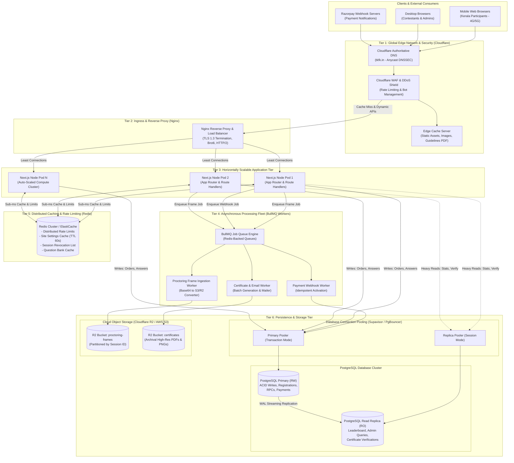
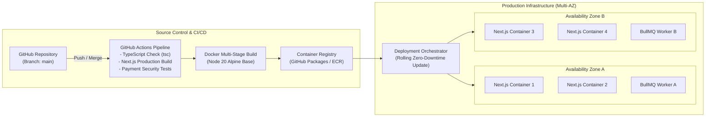

# 03 — Target System Architecture

> **Module:** Target Distributed Architecture, Tier Separation & Scalability Blueprint  
> **Status:** Proposed Production Architecture (Preserving Existing Application Code & Logic)  
> **Target Audience:** Principal Architects, Cloud Infrastructure Engineers, Lead DevOps

---

## 1. Architectural Vision & Evolution Strategy

The target system architecture evolves the existing Next.js + Supabase application into a **high-concurrency, resilient distributed system** capable of smoothly absorbing statewide traffic spikes (up to 100,000 concurrent users during peak exam or contest events) **without rewriting existing React components, altering UI/UX, or mutating business logic**.

The evolution adheres to the following core tenets:
1. **Preserve Application Logic:** The Next.js 14 App Router and existing service contracts (`PaymentService`, `QuizEngineService`, `DBService`) remain the core domain compute tier.
2. **Decouple Heavy Media & I/O:** Offload webcam proctoring frames and certificate PDFs from the transactional database to cloud object storage (Cloudflare R2 / AWS S3) via asynchronous queues.
3. **Decouple Fast Volatile Reads:** Introduce **Redis** as a distributed caching and rate-limiting tier to absorb repetitive reads (`system_config`, public settings, question banks, participant session verification).
4. **Scale Database Horizontally for Reads:** Separate transactional writes (Primary PostgreSQL) from read-heavy traffic (Read Replicas with PgBouncer/Supavisor connection pooling).
5. **Edge Security & Acceleration:** Front the entire platform with Cloudflare CDN/WAF and a managed Nginx Reverse Proxy cluster with TLS 1.3 termination, Brotli compression, and DDoS mitigation.

---

## 2. Tiered System Architecture

```
┌────────────────────────────────────────────────────────────────────────┐
│                        TARGET ARCHITECTURAL TIERS                      │
└────────────────────────────────────────────────────────────────────────┘

  [TIER 1: EDGE CDN & PERIMETER DEFENSE]
  Cloudflare Enterprise / Pro CDN + WAF + DDoS Shield + Edge Caching
  ─── Caches static JS/CSS, images, guidelines, and PDF resources
  ─── Blocks malicious bot traffic, layer 7 attacks, and brute force

  [TIER 2: INGRESS & REVERSE PROXY]
  Managed Nginx Cluster / Cloudflare API Gateway
  ─── Terminates TLS 1.3, manages HTTP/2 and HTTP/3 connections
  ─── Strips malicious headers, applies IP rate limits, gzip/brotli

  [TIER 3: COMPUTE APPLICATION CLUSTER]
  Stateless Next.js 14 Pods (Docker / Kubernetes / AWS ECS / Node.js)
  ─── Auto-scaling group (2 to 20 instances based on CPU / memory)
  ─── Server-Side Rendering (RSC) and dynamic JSON API route handlers
  ─── Zero local session state; fully stateless application runtime

  [TIER 4: ASYNCHRONOUS EVENT & WORKER FLEET]
  BullMQ + Node.js Worker Cluster
  ─── Worker Fleet 1: Proctoring Snapshot Ingestion & Storage Uploader
  ─── Worker Fleet 2: Asynchronous Payment Webhook Processing
  ─── Worker Fleet 3: Certificate Batch Generation & Email Dispatch

  [TIER 5: DISTRIBUTED CACHE & VOLATILE DATA]
  Redis Cluster (AWS ElastiCache / Redis Cloud / Upstash)
  ─── Distributed token blacklists and active session cache
  ─── Sub-millisecond distributed sliding window rate limiter
  ─── Cache-aside for site settings, questions bank, and leaderboards

  [TIER 6: PERSISTENCE & OBJECT STORAGE]
  1. PostgreSQL Primary (Supabase Dedicated / AWS RDS): All ACID writes
  2. PostgreSQL Read Replica: Queries for dashboards, verify, stats
  3. Cloudflare R2 / AWS S3: Immutable storage for webcam frames & certs
```

---

## 3. Target System Architecture Diagram (Diagram 2)



---

## 4. Production Deployment & CI/CD Pipeline (Diagram 16)



---

## 5. Architectural Improvements & Business Value

| Target Architecture Component | Operational Problem Solved | Expected Impact & Metric |
| :--- | :--- | :--- |
| **Cloudflare R2 Object Storage** | Eliminates storage of Base64 snapshot images in PostgreSQL. | Reduces DB disk bloat by > 90%; database backups complete 10x faster. |
| **Redis Distributed Cache** | Absorbs high-frequency reads for `system_config` and rate checks. | Reduces DB read load by 85%; eliminates cold-start rate-limit misses. |
| **BullMQ Asynchronous Workers** | Moves proctoring frames and email sending out of the HTTP request lifecycle. | Quiz autosave and frame reporting latency drops from ~350ms to < 45ms. |
| **Read Replica & Pooler** | Prevents long-running admin queries from locking quiz answer writes. | Zero connection starvation during peak concurrent exam submissions. |
| **Nginx Reverse Proxy** | Handles SSL/TLS handshakes, HTTP/2 multiplexing, and compression. | Decreases Node.js CPU usage by ~30%; improves page delivery speeds. |

Proceed to **[04-component-architecture.md](./04-component-architecture.md)** to examine the internal component breakdown and subsystem boundaries.
