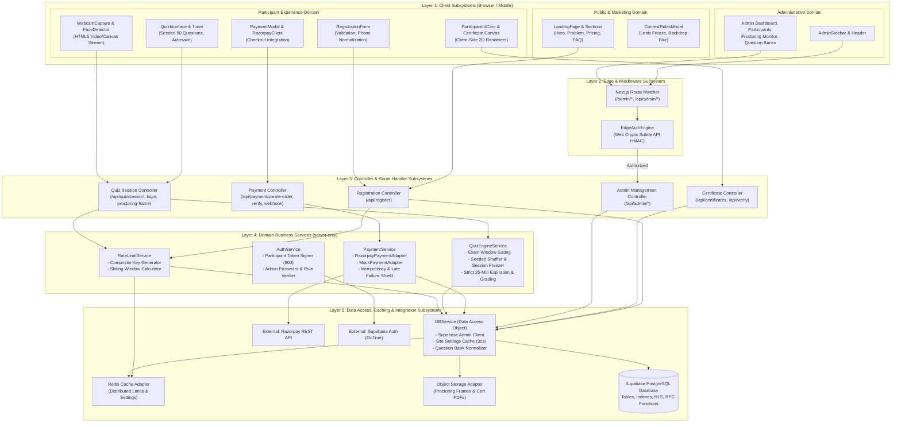

# 04 — Component Architecture

> **Module:** Subsystem Breakdown, Layered Boundaries & Component Responsibilities  
> **Status:** Grounded in Verified Source Code & Proposed Modular Separation  
> **Target Audience:** Full-Stack Engineers, Software Architects, Code Reviewers

---

## 1. Architectural Layering Model

The TKFK application architecture follows a **5-tier layered design** with strict one-directional dependency flows. Lower layers never depend on higher layers, and server-side components never cross the boundary into client-side bundles.

```
┌────────────────────────────────────────────────────────────────────────┐
│                        5-TIER LAYERED ARCHITECTURE                     │
├────────────────────────────────────────────────────────────────────────┤
│ Layer 1: Client Presentation & UI Subsystems (React / RSC / Canvas)    │
│ Layer 2: Edge Perimeter & Middleware Subsystems (Next.js Edge Runtime) │
│ Layer 3: API Controller & Route Handler Subsystems (App Router Routes) │
│ Layer 4: Domain Business Services Subsystems (Server-Only Singletons)  │
│ Layer 5: Data Access, Caching & External Integration Subsystems        │
└────────────────────────────────────────────────────────────────────────┘
```

---

## 2. Component Architecture Diagram (Diagram 4)



---

## 3. Subsystem Breakdown & Responsibility Matrix

### Subsystem A: Client Presentation Layer
| Component | Primary File(s) | Architectural Responsibilities |
| :--- | :--- | :--- |
| **`ContestRulesModal`** | `src/components/contest/ContestRulesModal.tsx` | Provides summary & full contest rules; locks background scrolling via `lenis.stop()` and `overscroll-contain`; renders frosted-glass backdrop blur (`14px`). |
| **`ParticipantIdCardCanvas`** | `src/components/ui/ParticipantIdCardCanvas.tsx` | Pure client-side HTML5 canvas renderer; draws official participant pass with live QR verification link, photo portrait, and watermarks without backend compute cost. |
| **`CertificateCanvas`** | `src/components/ui/CertificateCanvas.tsx` | Draws high-resolution printable award certificates with dynamic student name, score, grade, official signatures, and verification hash. |
| **`QuizInterface`** | `src/app/quiz/page.tsx` | Orchestrates interactive 50-question exam, 25-minute client countdown timer, auto-saves on answer selection, full-screen lockdown, and offline backup storage. |
| **`WebcamProctor`** | `src/lib/camera.ts`, `faceDetector.ts` | Requests camera permissions, samples video stream frames every 10–15 seconds, and reports face tracking status and telemetry to proctoring API. |

### Subsystem B: Edge & Middleware Layer
| Component | Primary File(s) | Architectural Responsibilities |
| :--- | :--- | :--- |
| **`NextRequest Middleware`** | `src/middleware.ts` | Intercepts all administrative page requests (`/admin/*`) and API endpoints (`/api/admin/*`); ensures zero unauthenticated calls reach the Node.js application server. |
| **`EdgeAuth`** | `src/lib/edgeAuth.ts` | Verifies HMAC-SHA256 admin tokens at the edge using the native Web Crypto Subtle API; operates with zero Node.js dependencies in < 2ms execution time. |

### Subsystem C: API Controller Layer
| Controller Group | Endpoints Managed | Architectural Responsibilities |
| :--- | :--- | :--- |
| **Registration API** | `POST /api/register` | Input sanitization, Indian mobile number canonicalization, state validation, and atomic registration orchestration. |
| **Payment APIs** | `POST /api/payment/create-order`<br/>`POST /api/payment/verify`<br/>`POST /api/payment/webhook` | Order initialization, client payment confirmation, and webhook signature verification with idempotency protection. |
| **Exam Engine APIs** | `POST /api/quiz/login`<br/>`GET/POST/PUT /api/quiz/session`<br/>`POST /api/quiz/proctoring-frame` | Participant authentication, session generation, real-time autosave upserts, frame telemetry recording, and final grading. |
| **Verification APIs** | `GET /api/certificates`<br/>`GET /api/verify` | Public certificate authenticity verification, ensuring strict suppression of private participant PII. |
| **Admin APIs** | `13 Endpoints under /api/admin/*` | Participant management, question bank authoring, proctoring live feeds, system configuration toggles, and audit logging. |

### Subsystem D: Domain Services Layer (`server-only`)
| Domain Service | Class Name & Location | Architectural Responsibilities |
| :--- | :--- | :--- |
| **`PaymentService`** | `PaymentService` (`src/services/payment/`) | Factory pattern returning `RazorpayPaymentAdapter` or `MockPaymentAdapter`; validates amount/currency, handles idempotency, and shields against out-of-order events. |
| **`QuizEngineService`** | `QuizEngineService` (`src/services/quizEngine.ts`) | Enforces competition entry window gating; computes seeded question randomization; freezes session questions; enforces strict 25-minute timeout. |
| **`DBService`** | `DBService` (`src/services/db.ts`) | Central data access object; encapsulates Supabase PostgreSQL client operations, connection pooling, and atomic transaction execution. |
| **`RateLimiter`** | `src/lib/rateLimit.ts` | Multi-tier rate limiter implementing in-memory sliding windows with fallback to PostgreSQL `rate_limits` table. |

Proceed to **[05-data-flow-and-sequence-diagrams.md](./05-data-flow-and-sequence-diagrams.md)** for sequence diagrams tracing core transaction lifecycles.
