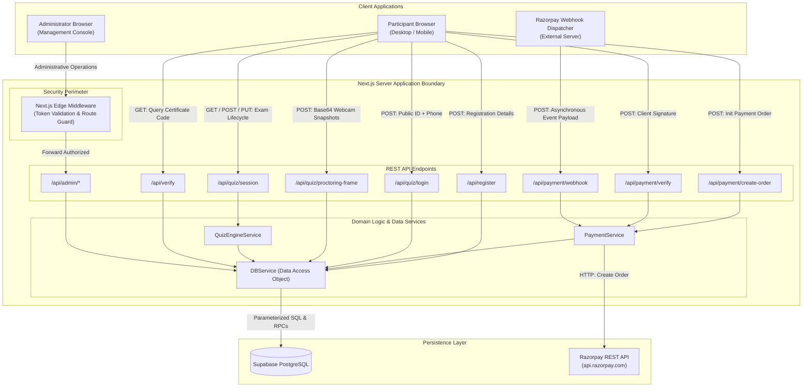
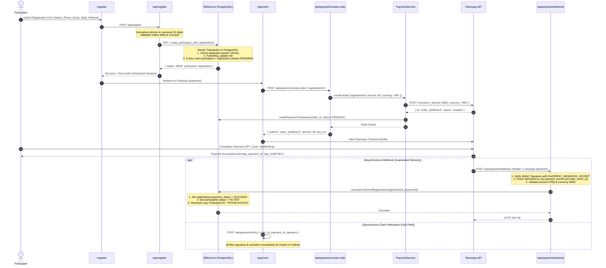
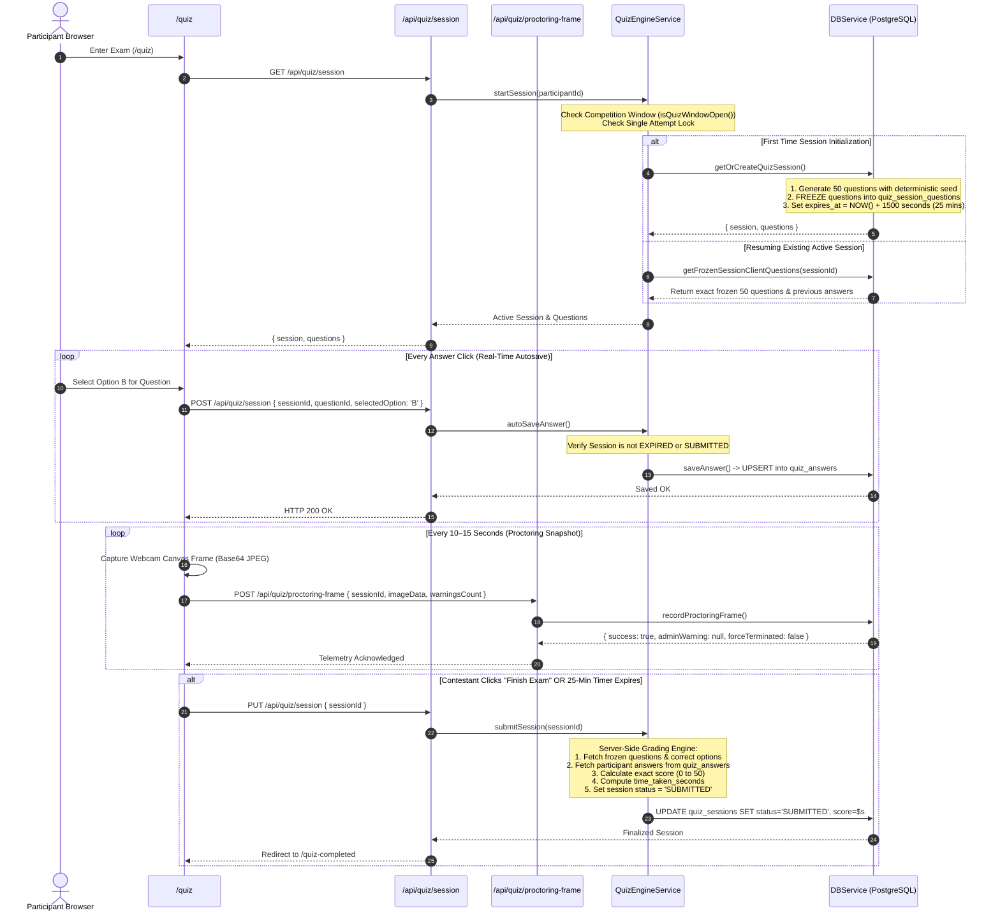
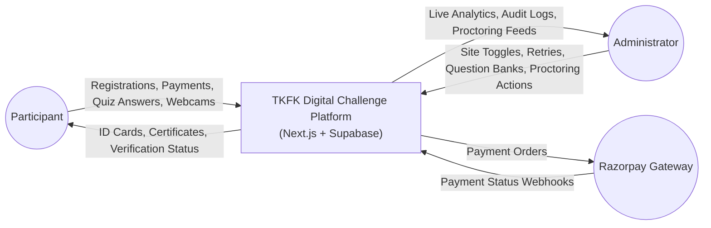
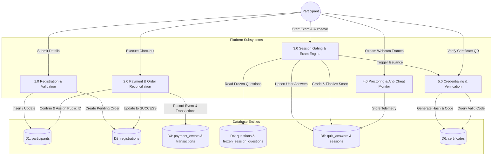
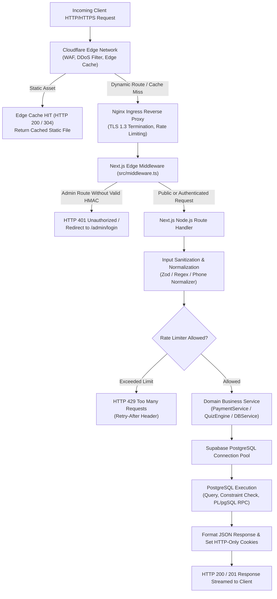

# 05 — Data Flow & Sequence Diagrams

> **Module:** System Sequences, End-to-End Tracing & Data-Flow Diagrams  
> **Status:** Grounded in Verified Source Code  
> **Target Audience:** Integration Engineers, Backend Developers, Security Auditors

---

## 1. API Communication Architecture (Diagram 6)

The diagram below maps how client applications, external providers, and internal backend components interact over HTTP/HTTPS protocols.



---

## 2. Authentication & Session Verification (Diagram 7)

```mermaid
sequenceDiagram
    autonumber
    actor Participant as Participant Browser
    participant API as /api/quiz/login
    participant DB as DBService
    participant Auth as participantAuth.ts
    participant Postgres as Supabase PostgreSQL

    Participant->>API: POST { participantId: "TKFK26-729150", phone: "9876543210" }
    Note over API: Rate Limit Check (10 req/min)
    API->>DB: authenticateParticipant("TKFK26-729150", "9876543210")
    DB->>Postgres: SELECT * FROM participants WHERE (participant_id = $1 OR email = $1)
    Postgres-->>DB: Participant Record Found
    Note over DB: Verify phone matches registered normalized_phone
    DB->>Postgres: SELECT * FROM registrations WHERE participant_id = $id
    Postgres-->>DB: Registration Record (payment_status = 'SUCCESS')
    DB-->>API: Validated Participant & Registration

    API->>Auth: signParticipantSessionToken(participant.id, participant.participant_id, 90)
    Note over Auth: Creates HMAC-SHA256 signature<br/>using PARTICIPANT_SESSION_SECRET<br/>(Zero PII in payload)
    Auth-->>API: Signed Token: "payloadBase64.hmacSignature"

    API-->>Participant: HTTP 200 OK + Set-Cookie: tkfk26_participant_session<br/>(HttpOnly, Secure, SameSite=Lax, Max-Age=90 days)
    Note over Participant: Client stores secure cookie automatically
```

---

## 3. End-to-End Registration & Payment Flow



---

## 4. Online Exam Lifecycle & Proctoring Telemetry Flow



---

## 5. System Data Flow Diagrams (Diagram 8)

### Level 0: Context Diagram


### Level 1: Functional Decomposition


---

## 6. HTTP Request Lifecycle (Diagram 9)



Proceed to **[06-database-design.md](./06-database-design.md)** for the complete schema, entity-relationship diagrams, and query performance optimizations.
