# 06 — Database Architecture & Storage Design

> **Module:** Relational Schema, Entity-Relationship Models, Indexing & Scaling  
> **Status:** Grounded in Verified PostgreSQL Schema (`supabase/schema.sql` & Migrations)  
> **Target Audience:** Database Architects, Senior Backend Engineers, DBAs

---

## 1. Verified Relational Database Schema

The platform datastore is hosted on **Supabase Managed PostgreSQL 15**, utilizing extensions `uuid-ossp` and `pgcrypto`.

The complete schema consists of **15 core relational tables** with explicit constraints and Row Level Security (RLS) policies:

```
┌────────────────────────────────────────────────────────────────────────┐
│                        VERIFIED DATABASE TABLES                        │
├──────────────────────────┬─────────────────────────────────────────────┤
│ Table Name               │ Primary Key & Key Constraints               │
├──────────────────────────┼─────────────────────────────────────────────┤
│ public.participants      │ id (UUID), participant_id (UNIQUE, nullable)│
│                          │ normalized_phone (UNIQUE), status CHECK     │
│ public.registrations     │ id (UUID), participant_id (FK CASCADE)      │
│                          │ registration_status CHECK, payment_status CK│
│ public.referral_codes    │ id (UUID), code (UNIQUE)                    │
│ public.questions         │ id (UUID), correct_option CHECK ('A'-'D')   │
│                          │ difficulty CHECK ('EASY','MEDIUM','HARD')   │
│ public.quiz_sessions     │ id (UUID), participant_id (FK, UNIQUE)      │
│                          │ status CHECK ('IN_PROGRESS','SUBMITTED'...) │
│ public.quiz_session_q... │ id (UUID), session_id (FK), question_id (FK)│
│                          │ UNIQUE(session_id, question_id)             │
│                          │ UNIQUE(session_id, question_order)          │
│ public.quiz_answers      │ id (UUID), session_id (FK), question_id (FK)│
│                          │ UNIQUE(session_id, question_id)             │
│ public.certificates      │ id (UUID), certificate_code (UNIQUE)        │
│                          │ participant_id (FK CASCADE)                 │
│ public.audit_logs        │ id (UUID), admin_user_id, action, timestamp │
│ public.system_config     │ key (TEXT PRIMARY KEY), value (JSONB)       │
│ public.admin_roles       │ id (UUID), email (UNIQUE), user_id (FK)     │
│                          │ role CHECK ('super_admin','admin','auditor')│
│ public.contact_messages  │ id (UUID), email, message, created_at       │
│ public.payment_trans...  │ id (UUID), registration_id (FK CASCADE)     │
│                          │ provider_order_id (UNIQUE), status CHECK    │
│ public.payment_events    │ id (UUID), provider_event_id (UNIQUE)       │
│ public.rate_limits       │ id (UUID), composite key + timestamp        │
└──────────────────────────┴─────────────────────────────────────────────┘
```

---

## 2. Entity-Relationship Diagram (Diagram 5)

```mermaid
erDiagram
    participants ||--o{ registrations : "places"
    participants ||--o| quiz_sessions : "attempts"
    participants ||--o| certificates : "earns"
    participants }o--o| referral_codes : "referred_by"
    
    registrations ||--o{ payment_transactions : "generates"
    registrations ||--o{ payment_events : "triggers"
    
    quiz_sessions ||--|{ quiz_session_questions : "freezes"
    quiz_sessions ||--o{ quiz_answers : "records"
    
    questions ||--o{ quiz_session_questions : "seeds"
    questions ||--o{ quiz_answers : "answered_in"

    admin_roles ||--o{ audit_logs : "executes"

    participants {
        uuid id PK
        text participant_id UK "TKFK26-XXXXXX (lazy assigned)"
        uuid auth_user_id UK
        text name
        text email
        text phone
        text normalized_phone UK "Canonical 10 digits"
        text college
        text state "Default 'Kerala'"
        text city
        text referral_code
        text status "PENDING | ACTIVE | BLOCKED | CANCELLED"
        timestamptz created_at
        timestamptz updated_at
    }

    registrations {
        uuid id PK
        uuid participant_id FK
        text registration_status "PENDING | CONFIRMED | CANCELLED"
        text payment_status "PENDING | SUCCESS | FAILED | REFUNDED | MANUAL_REVIEW"
        text payment_reference "razorpay_payment_id"
        integer amount "Default 99"
        text currency "Default INR"
        timestamptz confirmed_at
        timestamptz created_at
    }

    payment_transactions {
        uuid id PK
        uuid registration_id FK
        text provider "razorpay"
        text provider_order_id UK
        text provider_payment_id UK
        numeric amount "99.00"
        text currency "INR"
        text payment_status
        timestamptz created_at
    }

    payment_events {
        uuid id PK
        uuid registration_id FK
        text provider_event_id UK "Webhook Idempotency Key"
        text event_type "payment.captured"
        jsonb payload
        boolean processed
        timestamptz created_at
    }

    questions {
        uuid id PK
        text question_text
        text question_text_ml "Malayalam translation"
        text option_a
        text option_b
        text option_c
        text option_d
        char correct_option "A | B | C | D"
        text category
        text difficulty "EASY | MEDIUM | HARD"
        text explanation
    }

    quiz_sessions {
        uuid id PK
        uuid participant_id FK, UK "Single attempt guarantee"
        timestamptz started_at
        timestamptz expires_at "started_at + 25 mins"
        timestamptz submitted_at
        text status "IN_PROGRESS | SUBMITTED | EXPIRED"
        integer score "0 to 50"
        integer time_taken_seconds
        integer total_questions "Default 50"
    }

    quiz_session_questions {
        uuid id PK
        uuid session_id FK
        uuid question_id FK
        integer question_order "1 to 50 (Deterministic Seeded)"
        text question_text
        text option_a
        text option_b
        text option_c
        text option_d
        char correct_option
    }

    quiz_answers {
        uuid id PK
        uuid session_id FK
        uuid question_id FK
        char selected_option "A | B | C | D"
        timestamptz updated_at
    }

    certificates {
        uuid id PK
        text certificate_code UK "TKFK26-C-XXXXXX"
        uuid participant_id FK
        timestamptz issued_at
        text verification_hash "HMAC-SHA256 signature"
        numeric score_percentage "0.00 to 100.00"
        text grade "DISTINCTION | FIRST_CLASS | PASS"
    }

    referral_codes {
        uuid id PK
        text code UK
        boolean active
        integer usage_count
    }

    system_config {
        text key PK "e.g. results_release, portal_active"
        jsonb value
        boolean is_public
        timestamptz updated_at
    }

    admin_roles {
        uuid id PK
        uuid user_id FK
        text email UK
        text role "super_admin | admin | auditor"
    }

    audit_logs {
        uuid id PK
        text admin_user_id
        text action
        text entity_type
        text entity_id
        jsonb metadata
        timestamptz created_at
    }
```



---

## 3. Atomic Database Transactions & Stored Procedures

### The Atomic Registration Function (`create_participant_with_registration`)
To eliminate race conditions between checking participant existence and creating pending orders, the platform utilizes a PL/pgSQL stored procedure running under `SECURITY DEFINER`:

```sql
CREATE OR REPLACE FUNCTION public.create_participant_with_registration(
    p_participant_id TEXT DEFAULT NULL,
    p_name TEXT DEFAULT '',
    p_email TEXT DEFAULT '',
    p_phone TEXT DEFAULT '',
    p_state TEXT DEFAULT 'Kerala',
    p_city TEXT DEFAULT NULL,
    p_college TEXT DEFAULT NULL,
    p_referral_code TEXT DEFAULT NULL,
    p_amount NUMERIC DEFAULT 99,
    p_currency TEXT DEFAULT 'INR'
)
RETURNS JSONB
LANGUAGE plpgsql
SECURITY DEFINER
AS $$
DECLARE
    v_participant public.participants;
    v_registration public.registrations;
    v_existing_p public.participants;
    v_existing_r public.registrations;
    v_clean_phone TEXT;
BEGIN
    -- Canonical 10-digit phone number extraction
    v_clean_phone := REGEXP_REPLACE(p_phone, '[^0-9]', '', 'g');
    IF LENGTH(v_clean_phone) = 12 AND v_clean_phone LIKE '91%' THEN
        v_clean_phone := SUBSTRING(v_clean_phone FROM 3);
    ELSIF LENGTH(v_clean_phone) = 11 AND v_clean_phone LIKE '0%' THEN
        v_clean_phone := SUBSTRING(v_clean_phone FROM 2);
    END IF;

    -- Concurrency-safe lookup by email or normalized phone
    SELECT * INTO v_existing_p
    FROM public.participants
    WHERE LOWER(email) = LOWER(TRIM(p_email)) OR normalized_phone = v_clean_phone OR phone = v_clean_phone
    LIMIT 1;

    IF v_existing_p.id IS NOT NULL THEN
        SELECT * INTO v_existing_r
        FROM public.registrations
        WHERE participant_id = v_existing_p.id
        LIMIT 1;

        IF v_existing_r.payment_status = 'SUCCESS' OR v_existing_p.status = 'ACTIVE' THEN
            RETURN jsonb_build_object(
                'status', 'ALREADY_REGISTERED',
                'participant', to_jsonb(v_existing_p),
                'registration', to_jsonb(v_existing_r)
            );
        ELSIF v_existing_r.id IS NOT NULL THEN
            -- Resume existing pending checkout cleanly without duplicate rows
            UPDATE public.participants
            SET name = TRIM(p_name), state = TRIM(p_state), city = TRIM(p_city),
                college = TRIM(p_college), referral_code = UPPER(TRIM(p_referral_code)),
                status = 'PENDING', updated_at = NOW()
            WHERE id = v_existing_p.id
            RETURNING * INTO v_participant;

            UPDATE public.registrations
            SET payment_status = 'PENDING', registration_status = 'PENDING',
                amount = p_amount, currency = p_currency, updated_at = NOW()
            WHERE id = v_existing_r.id
            RETURNING * INTO v_registration;

            RETURN jsonb_build_object(
                'status', 'PENDING',
                'participant', to_jsonb(v_participant),
                'registration', to_jsonb(v_registration)
            );
        END IF;
    END IF;

    -- Insert participant atomically with lazy participant_id = NULL
    INSERT INTO public.participants (
        participant_id, name, email, phone, normalized_phone, state, city, college, referral_code, status
    ) VALUES (
        NULL, TRIM(p_name), LOWER(TRIM(p_email)), v_clean_phone, v_clean_phone,
        TRIM(p_state), TRIM(p_city), TRIM(p_college), UPPER(TRIM(p_referral_code)), 'PENDING'
    ) RETURNING * INTO v_participant;

    -- Insert corresponding registration in the exact same transaction block
    INSERT INTO public.registrations (
        participant_id, registration_status, payment_status, amount, currency
    ) VALUES (
        v_participant.id, 'PENDING', 'PENDING', p_amount, p_currency
    ) RETURNING * INTO v_registration;

    RETURN jsonb_build_object(
        'status', 'NEW',
        'participant', to_jsonb(v_participant),
        'registration', to_jsonb(v_registration)
    );
END;
$$;
```

---

## 4. Database Indexing Analysis & Optimization Blueprint

### 4.1 Existing Verified Indexes
```sql
-- participants
CREATE INDEX idx_participants_id ON public.participants(participant_id);
CREATE INDEX idx_participants_email ON public.participants(email);
CREATE INDEX idx_participants_phone ON public.participants(phone);
CREATE INDEX idx_participants_normalized_phone ON public.participants(normalized_phone);

-- registrations
CREATE INDEX idx_registrations_participant ON public.registrations(participant_id);
CREATE INDEX idx_registrations_payment_status ON public.registrations(payment_status);

-- quiz_session_questions
CREATE INDEX idx_quiz_session_questions_session ON public.quiz_session_questions(session_id);

-- rate_limits
CREATE INDEX idx_rate_limits_key_ts ON public.rate_limits(key, timestamp);
```

### 4.2 Proposed High-Impact Composite & Partial Indexes
Under peak examination and checkout concurrency, the following proposed indexes accelerate hot query paths without modifying table structures:

```sql
-- 1. Accelerates Participant Login Lookup (participant_id or normalized_phone)
CREATE INDEX IF NOT EXISTS idx_participants_auth_lookup 
ON public.participants (participant_id, normalized_phone) 
WHERE status = 'ACTIVE';

-- 2. Accelerates Webhook Order Lookup
CREATE INDEX IF NOT EXISTS idx_payment_tx_provider_order 
ON public.payment_transactions (provider_order_id, payment_status);

-- 3. Accelerates Quiz Autosave Upserts (Covering index on answers)
CREATE INDEX IF NOT EXISTS idx_quiz_answers_session_question_covering 
ON public.quiz_answers (session_id, question_id) 
INCLUDE (selected_option, updated_at);

-- 4. Accelerates Admin Live Leaderboard Queries (Eliminates full table scans)
CREATE INDEX IF NOT EXISTS idx_quiz_sessions_leaderboard 
ON public.quiz_sessions (status, score DESC, time_taken_seconds ASC) 
WHERE status = 'SUBMITTED';

-- 5. Accelerates Rate Limiting Window Scans
CREATE INDEX IF NOT EXISTS idx_rate_limits_window_cleanup 
ON public.rate_limits (timestamp DESC);
```

### 4.3 Query Performance Verification (EXPLAIN ANALYZE)
To verify index utilization, run:
```sql
EXPLAIN (ANALYZE, BUFFERS, VERBOSE)
SELECT qs.id, qs.participant_id, qs.score, qs.time_taken_seconds, p.name, p.college
FROM public.quiz_sessions qs
JOIN public.participants p ON p.id = qs.participant_id
WHERE qs.status = 'SUBMITTED'
ORDER BY qs.score DESC, qs.time_taken_seconds ASC
LIMIT 50;
```
* **Expected Result With Index:** `Index Scan using idx_quiz_sessions_leaderboard` with Execution Time < 5.0 ms.
* **Degraded Result Without Index:** `Seq Scan on quiz_sessions` followed by high-cost `Sort Method: quicksort` with Execution Time > 120.0 ms.

---

## 5. SQL vs NoSQL Architectural Evaluation

| Evaluation Criteria | PostgreSQL 15 (Current Choice) | MongoDB / DynamoDB (NoSQL Alternative) | Architectural Verdict |
| :--- | :--- | :--- | :--- |
| **Transaction Integrity (ACID)** | Full ACID across `participants` + `registrations` + `transactions`. | Document-level ACID; multi-document transactions incur high latency penalties. | **PostgreSQL Required:** Financial payment collection and single-attempt exam gating demand strict serialization. |
| **Referential Integrity** | Foreign keys enforce cascading deletes and orphan prevention. | Client-side application enforcement; prone to orphaned records during network cuts. | **PostgreSQL Required:** `quiz_session_questions` and `quiz_answers` require strict relational integrity. |
| **Data Schema Evolution** | Strongly typed columns with JSONB support for dynamic metadata. | Dynamic schema; schema drifts lead to subtle type mismatches in grading. | **PostgreSQL Required:** Question options ('A'-'D') and statuses require strict `CHECK` constraints. |
| **Read/Write Concurrency** | Highly optimized MVCC; supports PgBouncer transaction pooling. | High scale key-value lookups; poor support for complex relational leaderboards. | **PostgreSQL Optimal:** With connection pooling, PostgreSQL handles 10k concurrent users effortlessly. |

**Conclusion:** The choice of **PostgreSQL** is fully justified. No migration to NoSQL is recommended or required.

---

## 6. Replication, Partitioning & Sharding Strategy

```
┌────────────────────────────────────────────────────────────────────────┐
│                   DATABASE SCALING ARCHITECTURE                        │
└────────────────────────────────────────────────────────────────────────┘

  [TRANSACTIONAL WRITES] ──> [PRIMARY POSTGRESQL INSTANCE]
                                    │
                                    ├── Synchronous Write-Ahead Logging (WAL)
                                    ▼
  [ADMIN & VERIFY READS] ──> [HOT STANDBY READ REPLICA]
```

1. **Database Replication (Primary-Replica):**
   - Direct all write operations (`INSERT`, `UPDATE`, `RPCs`) to the Primary instance.
   - Offload heavy read traffic—specifically the Admin Dashboard, Export CSV scripts, Certificate public verifications (`/verify/[id]`), and Leaderboard tallying—to a **Read Replica**.
   - Replication lag under WAL streaming is typically `< 25 ms`, which is fully acceptable for administrative and verification views.

2. **Vertical Partitioning (Storage Isolation):**
   - `quiz_answers` and `proctoring_frames` generate high row volumes during active contests.
   - In the target architecture, heavy binary/Base64 image strings are removed from the database and routed to **Cloudflare R2 Object Storage**, leaving only lightweight metadata URLs in PostgreSQL.

3. **Horizontal Sharding Feasibility:**
   - At the projected scale of 50,000–100,000 participants per challenge, total database size remains well under **25 GB** (excluding raw images).
   - Horizontal sharding across multiple database nodes introduces cross-shard join overhead, two-phase commits, and operational complexity that is **unjustified** at this scale. A single properly indexed PostgreSQL Primary with a Read Replica provides 10x the headroom required.

Proceed to **[07-api-design.md](./07-api-design.md)** for the complete inventory of all 33 API contracts and REST specifications.
