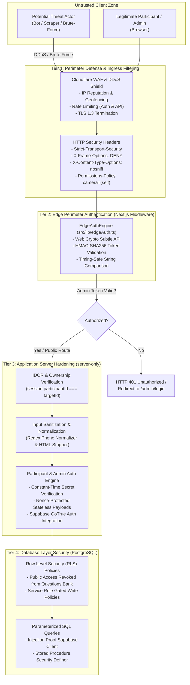

# 08 — Authentication, Authorization & Security Architecture

> **Module:** Cryptographic Sessions, RBAC, Edge Security & OWASP Top 10 Defense  
> **Status:** Grounded in Verified Source Code (`adminAuth.ts`, `participantAuth.ts`, `edgeAuth.ts`)  
> **Target Audience:** Security Engineers, Principal Architects, Compliance Auditors

---

## 1. Security Architecture (Diagram 17)



---

## 2. Authentication Mechanics

### 2.1 Participant Authentication (Stateless HMAC-SHA256 Tokens)
* **Login Vector:** Passwordless entry via `/api/quiz/login` using `participant_id` (or email) + registered `phone`.
* **Token Structure:** Dual-segment dot-separated format:
  $$\text{Token} = \text{base64url}(\text{Payload}) \,.\, \text{HMAC-SHA256}(\text{base64url}(\text{Payload}), \text{Secret})$$
* **Payload Specification (`ParticipantSessionPayload`):**
```typescript
export interface ParticipantSessionPayload {
  participantId: string; // Internal PostgreSQL UUID
  publicId: string;      // Public display ID: TKFK26-XXXXXX
  iat: number;           // Issued-at timestamp (Unix epoch ms)
  exp: number;           // Expiration timestamp (iat + 90 days)
  nonce: string;         // Cryptographically secure UUIDv4 nonce
}
```
* **Privacy by Design (Zero PII):** No email, phone number, participant name, or address is stored in the token payload.
* **Timing-Safe Verification:** Server-side token verification uses `crypto.timingSafeEqual` across all configured secrets to eliminate timing attack vulnerabilities.
* **Cookie Storage:** Emitted in HTTP-only, Secure, SameSite=Lax cookies with a 90-day persistence window (`tkfk26_participant_session`).

---

### 2.2 Administrative Authentication & RBAC
* **Credential Verification:** Admin authentication operates against Supabase Auth (`auth.users`) via `signInWithPassword()`.
* **Role-Based Access Control (RBAC):** Upon valid credential verification, the system looks up the administrator's assigned role in `public.admin_roles`:
  - `super_admin`: Full system control (site settings, delete participants, grant retries, manage question banks, toggle portal).
  - `admin`: Operational management (view participants, view proctoring, inspect payments, view audit logs).
  - `auditor`: Read-only access to verify competition integrity and results.
* **Emergency Master Secret:** If Supabase Auth is unreachable during an infrastructure outage, a high-entropy environment secret (`ADMIN_SECRET_KEY`) provides an authenticated emergency fallback for designated root administrative accounts.

---

### 2.3 Edge Authentication Engine (`src/lib/edgeAuth.ts`)
* Next.js Edge Middleware runs in a restricted V8 isolate that lacks Node.js native `crypto.createHmac`.
* The platform implements an edge authenticator using the **W3C Web Crypto Subtle API**:
```typescript
async function computeHmacSignatureEdge(payloadBase64: string): Promise<string> {
  const secret = getAdminSessionSecret();
  const encoder = new TextEncoder();
  const keyData = encoder.encode(secret);
  const msgData = encoder.encode(payloadBase64);

  const cryptoKey = await crypto.subtle.importKey(
    'raw',
    keyData,
    { name: 'HMAC', hash: 'SHA-256' },
    false,
    ['sign']
  );

  const signatureBuffer = await crypto.subtle.sign('HMAC', cryptoKey, msgData);
  return Array.from(new Uint8Array(signatureBuffer))
    .map(b => b.toString(16).padStart(2, '0'))
    .join('');
}
```
* Signature comparison is executed via a bitwise constant-time string comparison function (`timingSafeEqualStr`) to prevent byte-by-byte timing attacks at the network edge.

---

## 3. OWASP Top 10 Mitigation Matrix

| OWASP Vulnerability | Risk Scenario in Platform | Codebase Mitigation & Defense |
| :--- | :--- | :--- |
| **A01: Broken Access Control (IDOR)** | Participant attempts to submit exam answers or view proctoring streams for another user. | Every controller explicitly enforces ownership: `if (sessionPayload && !isAdmin && targetId !== sessionPayload.participantId) return 403 Forbidden;` |
| **A02: Cryptographic Failures** | Token forgery or session tampering via timing attacks. | All HMAC signatures are evaluated via `crypto.timingSafeEqual` and Web Crypto Subtle API; secrets are isolated with `import 'server-only'`. |
| **A03: Injection (SQLi & XSS)** | Malicious payloads injected via registration forms or contact inputs. | 1. Parameterized queries via Supabase client.<br/>2. PL/pgSQL stored procedures.<br/>3. String HTML sanitization (`sanitizeInput()`).<br/>4. React JSX automatic context-aware escaping. |
| **A04: Insecure Design** | Submitting exam answers after time has elapsed. | Server-side expiration enforcement: `expires_at = started_at + 25 mins`. Client timestamps are completely ignored for grading decisions. |
| **A05: Security Misconfiguration** | Clickjacking or MIME-sniffing attacks. | Enforced in `next.config.mjs`: `X-Frame-Options: DENY`, `X-Content-Type-Options: nosniff`, `Strict-Transport-Security: max-age=31536000`. |
| **A06: Vulnerable Components** | Known CVEs in npm dependencies. | Audited lockfile (`package-lock.json`), zero unnecessary dependencies, official pinned Next.js, Supabase, and Sharp libraries. |
| **A07: Identification & Auth Failures** | Brute-force credential stuffing against admin or participant login. | Multi-tier rate limiting via `checkRateLimitAsync()` (10 requests/min per IP + ID); persistent logging in `rate_limits` table. |
| **A08: Software & Data Integrity Failures** | Razorpay payment webhook spoofing or tampering. | Mandatory cryptographic HMAC-SHA256 signature verification (`x-razorpay-signature`) against raw request body before processing. |
| **A09: Security Logging & Monitoring Failures** | Untracked administrative tampering with scores or participant data. | All administrative actions are recorded in `public.audit_logs` with admin UID, action type, entity ID, and change metadata JSONB. |
| **A10: Server-Side Request Forgery (SSRF)** | Exploitation of internal network metadata endpoints via image uploads. | The platform does not fetch remote URLs on behalf of users; webcam frames are captured strictly in browser memory and posted as Base64 strings. |

---

## 4. Content Security Policy (CSP) & HTTP Headers

The following headers are verified in `next.config.mjs`:
```javascript
async headers() {
  return [
    {
      source: '/:path*',
      headers: [
        { key: 'X-Frame-Options', value: 'DENY' },
        { key: 'X-Content-Type-Options', value: 'nosniff' },
        { key: 'Referrer-Policy', value: 'strict-origin-when-cross-origin' },
        { key: 'Permissions-Policy', value: 'camera=(self), microphone=(), geolocation=()' },
        { key: 'Strict-Transport-Security', value: 'max-age=31536000; includeSubDomains' },
      ],
    },
  ];
}
```

* **Target CSP Enhancement:**
```http
Content-Security-Policy: default-src 'self'; script-src 'self' 'unsafe-inline' https://checkout.razorpay.com; style-src 'self' 'unsafe-inline' https://fonts.googleapis.com; img-src 'self' data: blob: https://*.supabase.co; font-src 'self' https://fonts.gstatic.com; connect-src 'self' https://*.supabase.co https://api.razorpay.com https://lumberjack.razorpay.com; frame-src https://api.razorpay.com;
```

Proceed to **[09-infrastructure-and-networking.md](./09-infrastructure-and-networking.md)** for DNS routing, reverse proxy configuration, and network topology.
