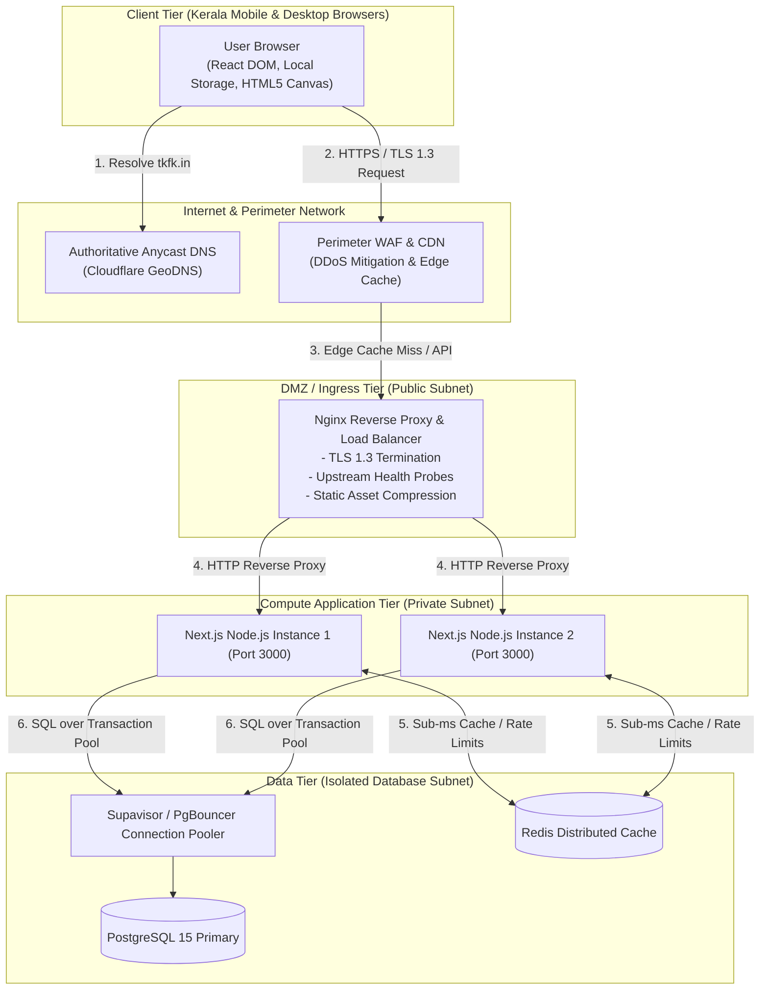

# 09 — Infrastructure, Networking & Reverse Proxy Design

> **Module:** Network Topology, DNS Architecture, Nginx Reverse Proxy & Latency Optimization  
> **Status:** Production Infrastructure Blueprint  
> **Target Audience:** DevOps Engineers, Network Architects, Systems Administrators

---

## 1. Client-Server Architecture (Diagram 3)

The platform implements a decoupled multi-tier client-server topology. The client browser executes React UI rendering, GSAP motion, and local canvas image generation, while the server enforces transactional security, state evaluation, and database consistency.



---

## 2. IP Addressing & Subnet Architecture

To ensure high security, the infrastructure is segmented across three isolated Virtual Private Cloud (VPC) subnets:

```
┌────────────────────────────────────────────────────────────────────────┐
│                        VPC SUBNET TOPOLOGY                             │
├─────────────────┬───────────────────┬───────────────┬──────────────────┤
│ Subnet Name     │ CIDR Block        │ Access Level  │ Hosted Services  │
├─────────────────┼───────────────────┼───────────────┼──────────────────┤
│ Public DMZ      │ 10.0.1.0/24 (AZ-A)│ Internet-     │ Nginx Reverse    │
│                 │ 10.0.2.0/24 (AZ-B)│ Facing        │ Proxies & NAT GW │
├─────────────────┼───────────────────┼───────────────┼──────────────────┤
│ Private Compute │ 10.0.10.0/24(AZ-A)│ Internal Only │ Next.js Cluster, │
│                 │ 10.0.20.0/24(AZ-B)│ (via NAT GW)  │ BullMQ Workers   │
├─────────────────┼───────────────────┼───────────────┼──────────────────┤
│ Isolated Data   │ 10.0.50.0/24(AZ-A)│ Completely    │ PostgreSQL,      │
│                 │ 10.0.60.0/24(AZ-B)│ Isolated      │ Redis Cluster    │
└─────────────────┴───────────────────┴───────────────┴──────────────────┘
```

* **Public IP Requirements:** Only the Nginx ingress load balancers and NAT Gateways possess public Elastic IP addresses.
* **Private IP Isolation:** Application pods and database instances have private IPs only (`10.0.x.x`), preventing direct internet probing.
* **Outbound Egress:** Application servers communicate with external APIs (Razorpay, Supabase Auth) through the NAT Gateway.

---

## 3. DNS Resolution Architecture (Diagram 10)

```mermaid
graph TD
    UserQuery["Client DNS Query: tkfk.in"] --> ISP_Resolver["Local ISP Recursive Resolver<br/>(e.g., Jio, Airtel, BSNL, Cloudflare 1.1.1.1)"]
    
    ISP_Resolver --> RootServer["Root Name Servers (.)"]
    RootServer --> TLDServer[".in ccTLD Name Servers"]
    TLDServer --> CloudflareNS["Cloudflare Anycast Authoritative Nameservers<br/>(ns1.cloudflare.com, ns2.cloudflare.com)"]
    
    CloudflareNS --> DNS_Records["DNS Zone File (tkfk.in)"]
    
    DNS_Records -->|A / AAAA Record (Proxied)| CF_AnycastIP["Cloudflare Edge Anycast IP<br/>(Optimized Routing to Kochi/Mumbai PoP)"]
    DNS_Records -->|CNAME / ALIAS| Subdomains["admin.tkfk.in / verify.tkfk.in"]
    DNS_Records -->|CAA Record| CertAuth["Let's Encrypt / DigiCert Only"]

    CF_AnycastIP --> EdgePoP["Nearest Edge PoP (Kochi / Chennai)"]
    EdgePoP --> OriginServer["Origin Nginx Reverse Proxy"]
```

### Production DNS Zone Records Table
```dns
; =========================================================================
; DNS Zone Records for tkfk.in (Cloudflare Anycast DNS)
; =========================================================================
$ORIGIN tkfk.in.
$TTL 300 ; 5 minutes for rapid failover

; Apex Domain Routing
@               IN  A       172.67.x.x      ; Cloudflare Anycast IPv4 (Proxied)
@               IN  AAAA    2606:4700::x    ; Cloudflare Anycast IPv6 (Proxied)

; Subdomains
www             IN  CNAME   tkfk.in.        ; Canonical alias
api             IN  CNAME   tkfk.in.        ; Direct API Gateway endpoint

; Security & Email Protection
@               IN  CAA     0 issue "letsencrypt.org"
@               IN  CAA     0 issuewild "letsencrypt.org"
@               IN  TXT     "v=spf1 include:_spf.google.com ~all"
_dmarc          IN  TXT     "v=DMARC1; p=reject; rua=mailto:theknowledgeforumkerala@gmail.com"
```

---

## 4. Nginx Reverse Proxy & SSL Termination Configuration

The configuration below provides production-grade TLS 1.3 termination, rate limiting, gzip/brotli compression, and upstream connection pooling.

```nginx
# =========================================================================
# Production Nginx Configuration (/etc/nginx/conf.d/tkfk.conf)
# =========================================================================

# Upstream Next.js Application Cluster
upstream nextjs_upstream {
    least_conn; # Route to instance with fewest active connections
    server 10.0.10.15:3000 max_fails=3 fail_timeout=10s;
    server 10.0.20.15:3000 max_fails=3 fail_timeout=10s;
    keepalive 64; # Maintain warm idle connections to Node.js
}

# Rate Limiting Zones
limit_req_zone $binary_remote_addr zone=api_limit:10m rate=20r/s;
limit_req_zone $binary_remote_addr zone=auth_limit:10m rate=5r/s;

# HTTP -> HTTPS Redirect Server Block
server {
    listen 80;
    listen [::]:80;
    server_name tkfk.in www.tkfk.in;
    return 301 https://$host$request_uri;
}

# HTTPS Primary Virtual Host
server {
    listen 443 ssl http2;
    listen [::]:443 ssl http2;
    server_name tkfk.in www.tkfk.in;

    # SSL / TLS 1.3 Configuration
    ssl_certificate /etc/letsencrypt/live/tkfk.in/fullchain.pem;
    ssl_certificate_key /etc/letsencrypt/live/tkfk.in/privkey.pem;
    ssl_protocols TLSv1.2 TLSv1.3;
    ssl_ciphers 'ECDHE-ECDSA-AES128-GCM-SHA256:ECDHE-RSA-AES128-GCM-SHA256:ECDHE-ECDSA-AES256-GCM-SHA384:ECDHE-RSA-AES256-GCM-SHA384';
    ssl_prefer_server_ciphers off;
    ssl_session_cache shared:SSL:20m;
    ssl_session_timeout 1d;
    ssl_session_tickets off;

    # HTTP Security Headers
    add_header X-Frame-Options "DENY" always;
    add_header X-Content-Type-Options "nosniff" always;
    add_header Referrer-Policy "strict-origin-when-cross-origin" always;
    add_header Strict-Transport-Security "max-age=31536000; includeSubDomains; preload" always;

    # Gzip Compression
    gzip on;
    gzip_vary on;
    gzip_proxied any;
    gzip_comp_level 6;
    gzip_types text/plain text/css text/xml application/json application/javascript application/xml+rss application/atom+xml image/svg+xml;

    # Client Request Buffer Limits (Accommodate proctoring Base64 images)
    client_max_body_size 8M;
    client_body_buffer_size 128k;

    # Static Next.js Bundles (Aggressive Browser Caching)
    location /_next/static/ {
        proxy_pass http://nextjs_upstream;
        proxy_http_version 1.1;
        proxy_set_header Connection "";
        expires 365d;
        add_header Cache-Control "public, max-age=31536000, immutable";
    }

    # Public Static Media Assets
    location /images/ {
        proxy_pass http://nextjs_upstream;
        expires 30d;
        add_header Cache-Control "public, max-age=2592000";
    }

    # Authentication Endpoints Rate Limiting
    location ~* ^/api/(quiz/login|admin/login|register) {
        limit_req zone=auth_limit burst=10 nodelay;
        proxy_pass http://nextjs_upstream;
        proxy_http_version 1.1;
        proxy_set_header Connection "";
        proxy_set_header Host $host;
        proxy_set_header X-Real-IP $remote_addr;
        proxy_set_header X-Forwarded-For $proxy_add_x_forwarded_for;
        proxy_set_header X-Forwarded-Proto $scheme;
    }

    # General Dynamic API Endpoints
    location /api/ {
        limit_req zone=api_limit burst=30 nodelay;
        proxy_pass http://nextjs_upstream;
        proxy_http_version 1.1;
        proxy_set_header Connection "";
        proxy_set_header Host $host;
        proxy_set_header X-Real-IP $remote_addr;
        proxy_set_header X-Forwarded-For $proxy_add_x_forwarded_for;
        proxy_set_header X-Forwarded-Proto $scheme;
    }

    # Default App Router Fallback
    location / {
        proxy_pass http://nextjs_upstream;
        proxy_http_version 1.1;
        proxy_set_header Connection "";
        proxy_set_header Host $host;
        proxy_set_header X-Real-IP $remote_addr;
        proxy_set_header X-Forwarded-For $proxy_add_x_forwarded_for;
        proxy_set_header X-Forwarded-Proto $scheme;
    }
}
```

---

## 5. Latency Profile & Optimization Analysis

### 5.1 Latency Sources & Measurements
1. **Network Transit Distance:** A participant accessing the application from Malappuram or Thiruvananthapuram over 4G experiences **35–80 ms** of radio network latency before reaching origin servers.
2. **Database Round Trips:** Without connection pooling, establishing a new TLS connection to Supabase PostgreSQL takes **120–220 ms**.
3. **Proctoring Frame Ingestion:** Posting a 250 KB Base64 image over mobile uplinks takes **150–400 ms** per frame.

### 5.2 Latency Reduction Strategies
* **Edge Anycast Routing:** Cloudflare routes traffic to nearest edge PoPs (Kochi, Chennai, Mumbai), reducing network round-trip time (RTT) by up to **45%**.
* **HTTP/2 Multiplexing:** Enables concurrent delivery of page scripts, stylesheets, and fonts over a single TCP connection, eliminating head-of-line blocking.
* **Warm Database Keepalive:** Connection poolers (Supavisor) eliminate TCP handshake overhead on every query, reducing DB latency to **< 5 ms**.

Proceed to **[10-scaling-and-performance.md](./10-scaling-and-performance.md)** for capacity planning and performance engineering across traffic tiers.
