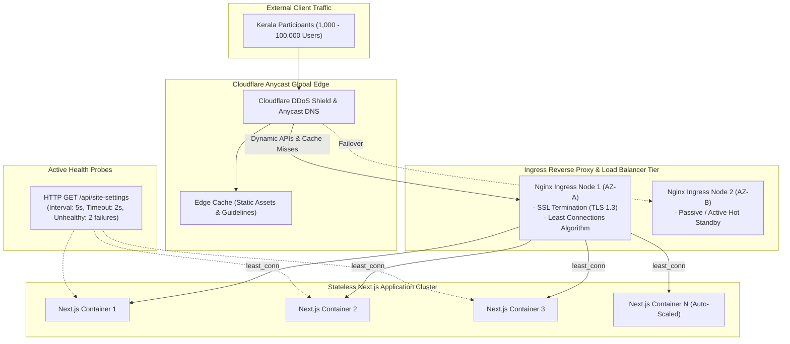

# 10 — Scaling Strategies, Concurrency & Capacity Planning

> **Module:** Concurrency Tiers, Load Balancing, Capacity Modeling & Bottleneck Audits  
> **Status:** Grounded Engineering Modeling (100 to 100,000 Concurrent Users)  
> **Target Audience:** Principal Systems Architects, SREs, Performance Engineers

---

## 1. Concurrency Traffic Profiles & Modeling Assumptions

To perform realistic capacity planning for statewide Kerala competitions, we model participant behavior during an active **60-minute competition window** with the following behavioral assumptions:

```
┌────────────────────────────────────────────────────────────────────────┐
│                     USER ACTION TRAFFIC COEFFICIENTS                   │
├─────────────────────────┬───────────────────────────────┬──────────────┤
│ User Action             │ Frequency per User            │ Payload Size │
├─────────────────────────┼───────────────────────────────┼──────────────┤
│ Static Page Navigation  │ 3 page views / session        │ ~25 KB (gz)  │
│ Exam Question Autosave  │ 50 questions / 25 min (~1/30s)│ ~500 B       │
│ Proctoring Frame Post   │ 1 frame / 15 seconds          │ ~120 KB      │
│ Session Ping / Check    │ 1 ping / 30 seconds           │ ~300 B       │
└─────────────────────────┴───────────────────────────────┴──────────────┘
```

* **Peak Write Request Rate Formula:**
$$\text{RPS}_{\text{exam}} = N \times \left( \frac{1 \text{ autosave}}{30\text{ s}} + \frac{1 \text{ frame}}{15\text{ s}} + \frac{1 \text{ ping}}{30\text{ s}} \right) = N \times (0.033 + 0.067 + 0.033) \approx N \times 0.133 \text{ req/sec}$$

---

## 2. Capacity Planning Across 4 Traffic Tiers

```
┌────────────────────────────────────────────────────────────────────────┐
│                        CAPACITY PLANNING MATRIX                        │
├────────────────────┬───────────┬─────────────┬────────────┬────────────┤
│ Metric             │ Tier 1    │ Tier 2      │ Tier 3     │ Tier 4     │
│                    │ (100 users│ (1,000 users│ (10,000 usr│ (100,000 u)│
├────────────────────┼───────────┼─────────────┼────────────┼────────────┤
│ Active Requests/sec│ ~15 rps   │ ~150 rps    │ ~1,500 rps │ ~15,000 rps│
│ Network Bandwidth  │ ~15 Mbps  │ ~150 Mbps   │ ~1.5 Gbps  │ ~15 Gbps   │
│ Compute Instances  │ 1 Node    │ 2-3 Pods    │ 8-12 Pods  │ 40-60 Pods │
│ Total CPU Cores    │ 2 vCPU    │ 6 vCPU      │ 24 vCPU    │ 120 vCPU   │
│ Total RAM          │ 4 GB      │ 12 GB       │ 48 GB      │ 240 GB     │
│ DB Connection Pool │ 15 conns  │ 40 conns    │ 80 conns   │ 150 conns  │
│ Distributed Cache  │ In-memory │ Single Redis│ Redis Clust│ Redis Clust│
│ Storage Strategy   │ Direct DB │ Async S3/R2 │ R2 Direct  │ R2 Direct  │
│ Infrastructure Cost│ ~$30/mo   │ ~$120/mo    │ ~$550/mo   │ ~$2,200/mo │
└────────────────────┴───────────┴─────────────┴────────────┴────────────┘
```

---

### Tier 1: 100 Concurrent Users (Nominal Operational Load)
* **Request Volume:** ~15 req/sec (10 telemetry posts/sec, 3 autosaves/sec, 2 reads/sec).
* **Application Server:** Single instance (2 vCPU, 4 GB RAM) running Node.js.
* **Database Connections:** 10–15 active connections to Supabase PostgreSQL.
* **Bottlenecks:** None. Current implementation runs effortlessly within free/starter tier limits.
* **Architecture:** Monolithic Next.js application server with existing in-memory cache and direct Supabase database operations.

---

### Tier 2: 1,000 Concurrent Users (Medium Contest Peak)
* **Request Volume:** ~150 req/sec (67 webcam frames/sec, 33 autosaves/sec, 50 queries/sec).
* **Application Server:** 2–3 stateless Next.js container pods (each 2 vCPU, 4 GB RAM) load-balanced via Nginx.
* **Database Connections:** Connection pooler (Supavisor / PgBouncer) configured with 40 pooled transaction connections.
* **Bandwidth:** ~150 Mbps outbound/inbound (driven largely by Base64 webcam frame uploads).
* **Identified Bottlenecks:**
  1. Base64 webcam frames written directly to `DBService` cause PostgreSQL table bloat.
  2. In-memory rate limiting becomes inconsistent across multiple pods.
* **Required Mitigations:**
  1. Introduce **Redis** for distributed rate limiting and caching.
  2. Implement an asynchronous worker to offload proctoring frames.

---

### Tier 3: 10,000 Concurrent Users (Large Statewide Challenge)
* **Request Volume:** ~1,500 req/sec (667 webcam frames/sec, 333 autosaves/sec, 500 status checks/sec).
* **Application Server:** Auto-scaled cluster of **8 to 12 Next.js pods** (2 vCPU, 4 GB RAM each) across 2 Availability Zones.
* **Compute Footprint:** 24 vCPU, 48 GB RAM aggregate.
* **Database Architecture:**
  - Dedicated PostgreSQL Primary (8 vCPU, 32 GB RAM, SSD NVMe storage).
  - PostgreSQL Read Replica (4 vCPU, 16 GB RAM) handling admin queries, verifications, and stats.
  - Connection Pooler: Supavisor running in `Transaction Mode` with 80 client connections.
* **Bandwidth:** ~1.5 Gbps network transit. Cloudflare CDN edge caching absorbs 95% of static asset traffic.
* **Identified Bottlenecks:**
  1. Direct database writes for proctoring frames will exhaust database IOPS.
  2. Leaderboard calculation triggers full table scans on `quiz_sessions`.
* **Required Mitigations:**
  1. **Cloudflare R2 Direct Uploads:** Quiz client uploads webcam frames directly to R2 via pre-signed URLs, completely bypassing the Next.js and PostgreSQL servers for binary payloads.
  2. Composite index on `(status, score DESC, time_taken_seconds ASC)`.

---

### Tier 4: 100,000 Concurrent Users (Massive Statewide Event)
* **Request Volume:** ~15,000 req/sec peak.
* **Application Server:** Managed Kubernetes (EKS / GKE) cluster auto-scaling between **40 and 60 Next.js container pods**.
* **Compute Footprint:** 120 vCPU, 240 GB RAM aggregate.
* **Database Architecture:**
  - Enterprise Primary PostgreSQL (32 vCPU, 128 GB RAM) dedicated exclusively to payment and exam answer transactions.
  - Multiple Read Replicas (2x 16 vCPU, 64 GB RAM) for administrative dashboards and participant lookups.
  - Highly Available Redis Cluster (3 shards, 3 replicas) handling rate limiting, token revocation, and cache-aside lookups.
* **Bandwidth:** ~15 Gbps ingress/egress.
* **Bottlenecks & Mitigations:**
  1. **Exam Window Thundering Herd:** When the contest opens at 3:00 PM, 100,000 students request `/api/quiz/session` within 60 seconds.
  2. **Mitigation:** Pre-generate and cache frozen question sets in Redis. Clients receive questions from Redis in < 2ms, reducing database query volume by 99%.

---

## 3. Load Balancing & Traffic Distribution (Diagram 13)



### Load Balancing Policy
* **Algorithm:** `least_conn` (Least Connections) is selected over Round-Robin. Because autosave requests are lightweight (~15ms) while proctoring frame posts are heavy (~150ms), routing to the node with the lowest connection count ensures balanced CPU utilization.
* **Session Stickiness:** **Disabled**. The Next.js application tier is 100% stateless; requests carry self-contained HMAC session tokens in cookies. Disabling session stickiness allows instant traffic redistribution during pod scaling.

---

## 4. Vertical vs Horizontal Scaling Analysis

| Scaling Paradigm | Applicability to TKFK Platform | Advantages | Disadvantages |
| :--- | :--- | :--- | :--- |
| **Vertical Scaling (Scaling Up)** | **Database Tier Only**<br/>(Upgrading Supabase instance from 2 vCPU / 4GB to 8 vCPU / 32GB). | Zero architectural changes; maintains strict relational consistency without distributed coordination. | Hard ceiling; requires planned maintenance windows for RAM/CPU upgrades. |
| **Horizontal Scaling (Scaling Out)** | **Compute & Worker Tiers**<br/>(Adding Next.js pods from 2 to 20 based on CPU utilization). | Elastic; dynamic scale-down saves operational cost; zero downtime during pod additions. | Requires external centralized caching (Redis) and stateless session management. |

**Architectural Verdict:** The platform adopts **hybrid scaling**:
- Compute (Next.js) and Background Workers (BullMQ) scale **horizontally** behind Nginx.
- Transactional Relational Database (PostgreSQL) scales **vertically** for ACID writes, complemented by horizontal Read Replicas for reporting queries.

Proceed to **[11-caching-and-storage.md](./11-caching-and-storage.md)** for caching tiers and cloud object storage design.
