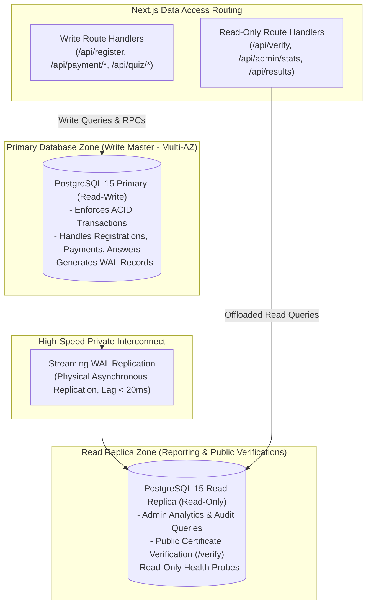

# 12 — Distributed Systems, Asynchronous Queues & CAP Theorem

> **Module:** Distributed Consistency, CAP Analysis, BullMQ Queues & Replication  
> **Status:** Production Distributed Systems Blueprint  
> **Target Audience:** Distributed Systems Architects, Senior Backend Engineers, SREs

---

## 1. CAP Theorem Analysis Applied to Platform Domains (Concept 22)

The **CAP Theorem** states that a distributed datastore can simultaneously guarantee at most two out of three properties: **Consistency (C)**, **Availability (A)**, and **Partition Tolerance (P)**. Since network partitions ($P$) are unavoidable in real-world distributed networks, systems must make explicit trade-offs between $C$ and $A$.

Rather than treating CAP as a single blanket rule for the entire application, the TKFK platform applies nuanced CAP trade-offs across distinct business subsystems:

```
┌────────────────────────────────────────────────────────────────────────┐
│                        CAP DOMAIN CLASSIFICATION                       │
├─────────────────────┬─────────┬────────────────────────────────────────┤
│ Application Domain  │ System  │ Rationale & Architectural Behavior     │
├─────────────────────┼─────────┼────────────────────────────────────────┤
│ Payment & Orders    │ **CP**  │ Strict Consistency is mandatory. Double│
│                     │         │ spends or duplicate activations cannot │
│                     │         │ be tolerated. If DB is partitioned,    │
│                     │         │ checkout fails gracefully.             │
├─────────────────────┼─────────┼────────────────────────────────────────┤
│ Quiz Timer & Answers│ **AP**  │ High Availability is mandatory. Exam   │
│                     │ (Event- │ takers must never be blocked mid-quiz. │
│                     │ ually C)│ Answers buffer locally in LocalStorage │
│                     │         │ and sync eventually to PostgreSQL.     │
├─────────────────────┼─────────┼────────────────────────────────────────┤
│ Proctoring Feeds    │ **AP**  │ Best-effort availability. Dropped      │
│                     │         │ webcam frames do not invalidate an     │
│                     │         │ exam; continuity takes precedence.     │
├─────────────────────┼─────────┼────────────────────────────────────────┤
│ Results & Analytics │ **AP**  │ Eventual consistency. Administrative   │
│                     │         │ stats and leaderboards tolerate 30-sec │
│                     │         │ replication lag from Read Replicas.    │
└─────────────────────┴─────────┴────────────────────────────────────────┘
```

---

## 2. Database Replication Architecture (Diagram 14)



---

## 3. Asynchronous Message Queues & Worker Fleet (Diagram 15)

During peak examination surges, operations such as converting Base64 webcam snapshots to images, rendering PDF certificates, and dispatching transactional emails should never block the Next.js HTTP event loop. 

The architecture introduces **BullMQ** (Redis-backed distributed queue) to decouple asynchronous tasks.

```mermaid
graph TD
    subgraph Producers ["Task Producers (Next.js Compute Pods)"]
        Pod_Web["Next.js Route Handlers"]
    end

    subgraph Queue_Broker ["Redis-Backed Distributed Queue Broker (BullMQ)"]
        Q_Frames[("Queue: proctoring-frames<br/>Concurrency: 20 workers")]
        Q_Webhooks[("Queue: payment-webhooks<br/>Concurrency: 5 workers")]
        Q_Certs[("Queue: certificate-generation<br/>Concurrency: 10 workers")]
        Q_DLQ[("Dead-Letter Queue (DLQ)<br/>Persistent Failed Jobs")]
    end

    subgraph Consumer_Workers ["Dedicated Worker Pods (Node.js Background Fleet)"]
        W_Frame["Proctoring Worker Fleet<br/>- Decodes Base64 JPEG<br/>- Compresses & Uploads to R2<br/>- Updates DB Frame URL"]
        W_Pay["Payment Reconciler Worker<br/>- Processes Webhook Event<br/>- Activates Participant"]
        W_Cert["Certificate Worker<br/>- Generates PDF / Canvas Hash<br/>- Dispatches Email Confirmation"]
    end

    subgraph Sinks ["External Storage & Notification Sinks"]
        R2_Store[("Cloudflare R2 Bucket")]
        SMTP_Server["Transactional Email (Resend / SES)"]
        Postgres[(PostgreSQL Database)]
    end

    Pod_Web -->|1. Enqueue Job (Payload < 5KB)| Q_Frames
    Pod_Web -->|1. Enqueue Webhook| Q_Webhooks
    Pod_Web -->|1. Enqueue Cert Request| Q_Certs

    Q_Frames --> W_Frame
    Q_Webhooks --> W_Pay
    Q_Certs --> W_Cert

    W_Frame --> R2_Store
    W_Pay --> Postgres
    W_Cert --> SMTP_Server

    W_Frame -.->|Failed 3x with Backoff| Q_DLQ
    W_Pay -.->|Failed 3x with Backoff| Q_DLQ
```

### Queue Technology Evaluation: BullMQ vs RabbitMQ vs AWS SQS
* **BullMQ (Redis-Backed): Selected.** Because Redis is already required for distributed caching and rate limiting, BullMQ introduces zero new infrastructure dependencies. It delivers over 25,000 ops/sec, supports sub-second job delays, and integrates seamlessly with TypeScript.
* **RabbitMQ:** Powerful AMQP broker, but introduces high operational overhead (Erlang runtime, clustering maintenance) unnecessary for this scale.
* **AWS SQS:** Fully managed, but adds cloud vendor lock-in and higher latency (50–100ms API calls vs 2ms Redis pushes).

---

## 4. WebSockets vs HTTP Polling Architecture (Concept 24)

| Operational Feature | Protocol Evaluated | Architectural Selection & Rationale |
| :--- | :--- | :--- |
| **Exam Autosave** | WebSockets vs HTTP POST | **HTTP POST Selected:** Answer selections are discrete, sporadic events (every 20–30s). HTTP POST over keepalive HTTP/2 avoids maintaining 10,000 persistent stateful socket connections. |
| **Proctoring Frame Posts** | WebSockets vs HTTP POST | **HTTP POST Selected:** Sending 120 KB binary snapshots over HTTP POST enables direct streaming to workers/storage without head-of-line WebSocket frame blocking. |
| **Admin Live Proctoring** | WebSockets vs HTTP Polling | **HTTP Short-Polling (5s) with SSE Path:** For the small administrative team (1–5 concurrent admins monitoring the exam), polling `/api/admin/proctoring` with 5s intervals is simple, robust, and requires zero stateful socket infrastructure. |

---

## 5. Modular Monolith vs Microservices Evaluation (Concept 26)

```
┌────────────────────────────────────────────────────────────────────────┐
│               MODULAR MONOLITH VS MICROSERVICES TRADEOFF               │
├──────────────────────┬─────────────────────────┬───────────────────────┤
│ Dimension            │ Next.js Modular Monolith│ Microservices Cluster │
├──────────────────────┼─────────────────────────┼───────────────────────┤
│ Deployment Overhead  │ Single Docker / Pod unit│ 4+ independent service│
│                      │ Zero network RPC latency│ deployments & mesh    │
├──────────────────────┼─────────────────────────┼───────────────────────┤
│ Data Consistency     │ Single DB transactions; │ Distributed trans-    │
│                      │ foreign key guarantees  │ actions (Saga pattern)│
├──────────────────────┼─────────────────────────┼───────────────────────┤
│ Team Cognitive Load  │ Low; unified TypeScript │ High; distributed     │
│                      │ code repository         │ contracts & versioning│
├──────────────────────┼─────────────────────────┼───────────────────────┤
│ Scaling Flexibility  │ Scales whole container  │ Scales services       │
│                      │ (Extremely cheap today) │ independently         │
└──────────────────────┴─────────────────────────┴───────────────────────┘
```

**Architectural Verdict:** The platform is engineered as a **Modular Monolith**. 

Microservices introduce distributed tracing complexity, network hop latency, and eventual consistency dilemmas that would jeopardize single-attempt exam constraints and payment reconciliation. 

If future organizational scale dictates service extraction, the clean boundaries already established in the codebase map cleanly to future microservice boundaries:
1. `Auth & Participant Service`
2. `Payment & Webhook Ingestion Service`
3. `Examination & Proctoring Engine`
4. `Marketing & Information Portal`

Proceed to **[13-reliability-and-observability.md](./13-reliability-and-observability.md)** for health probes, logging, disaster recovery, and fault tolerance design.
